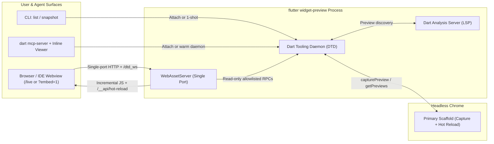

# RFC 510.0000: Headless, CLI, and Interactive Live Widget Previews

**Prototype branches:** [`bkonyi/flutter` (`wp-pr/01` through `wp-pr/11`)](https://github.com/bkonyi/flutter/tree/wp-pr/11-embed-selection) · [`bkonyi/ai` (`wp-mcp-pr/01` through `wp-mcp-pr/04`)](https://github.com/bkonyi/ai/tree/wp-mcp-pr/04-selection-crop)

## Overview

`flutter widget-preview` lets developers inspect widgets marked with `@Preview` without launching a full Flutter app. Today, the tool assumes a human sits in front of a local desktop browser or IDE panel. It offers no scriptable CLI output, no structured layout error reporting, no way for AI coding agents to view rendered widgets, and no lightweight single-port view that works cleanly over SSH tunnels or remote workspaces.

This RFC extends `flutter widget-preview` and `dart mcp-server` in four ways:

1. **Headless CLI commands** (`list`, `snapshot`, and `start --headless --machine`) for terminals, scripts, and CI pipelines.
2. **Structured per-preview diagnostics** that catch build exceptions, `RenderFlex` overflows (with exact overflowing pixels and edge), unconstrained layouts, clipped text, and undersized tap targets.
3. **MCP tools and an inline interactive viewer** in `dart mcp-server` so AI agents and developers can render, compare, and visually annotate widgets right inside chat.
4. **A single-port `/live` view** served directly by `flutter widget-preview` with side-by-side Light and Dark previews, responsive width dragging, vector zoom, and flash-free hot reload.

All four experiences build on standard `@Preview` and `@MultiPreview` annotations already in `package:flutter/widget_previews.dart`. Existing previews work without code changes.

## Goals

- **Zero-setup visual feedback for UI edits:** Let developers and AI agents render any `@Preview` in seconds without booting an emulator, simulator, or full app shell.
- **Actionable layout diagnostics:** Report exact failure phase, overflow pixel count, overflowing side, and accessibility warnings alongside every captured PNG.
- **Fast human-in-the-loop iteration:** Support side-by-side Light and Dark inspection, responsive width presets, drag-to-resize handles, `25%` to `400%` zoom, Before/After comparison, and multi-region visual selection.
- **Works anywhere Flutter runs:** Run reliably in local browsers, VS Code Remote SSH, GitHub Codespaces, Dev Containers, Linux CI containers, and any MCP host (VS Code, Cursor, Claude Desktop, Gemini CLI, or custom clients) with zero extra proxy processes.
- **Coexist with open IDE sessions:** Automatically attach to an already-running IDE widget preview session for the same project instead of spawning a conflicting daemon or modifying tracked `.gitignore` files during headless runs.
- **No new `flutter_tools` package dependencies:** Keep `package:dart_mcp` and MCP tool logic in `dart-lang/ai` (`dart mcp-server`), not in `flutter_tools`.

### Non-Goals

- **Synthetic preview injection:** Agents and scripts use real `@Preview` and `@MultiPreview` declarations in project source files rather than splicing temporary Dart expressions into generated code.
- **Automated gesture scripting over DTD:** Programmatic tapping, typing, and scrolling inside a preview (`interact`) remain future work.
- **Replacing `flutter test` golden tests:** Headless snapshots complement widget tests by speeding up exploratory UI authoring and layout audits; deterministic CI goldens remain the job of `flutter_test`.

## Background

Flutter developers use `@Preview` annotations to view isolated components during UI development:

```dart
import 'package:flutter/material.dart';
import 'package:flutter/widget_previews.dart';

@Preview(group: 'Cards', name: 'Status Card')
Widget statusCardPreview() {
  return const StatusCard(
    title: 'Release Pipeline',
    badge: 'Draft Ready',
    subtitle: '42 checks passed in 1.8s across Linux, macOS, and Web targets',
  );
}
```

Currently, running `flutter widget-preview start` launches a desktop Chrome window connected to the Flutter Web debug service (DWDS) and the Dart Tooling Daemon (DTD). While useful for a single local browser tab, several everyday workflows hit friction:

- **AI coding agents fly blind on UI:** An agent can edit Dart code and run `dart analyze`, but it cannot see whether a card overflows by 14 pixels on a 375px phone screen, looks unreadable in Dark mode, or breaks at 2x font scale.
- **Developers struggle to describe visual tweaks in text:** Saying "make the second badge a little less cramped" is slow and ambiguous compared to dragging a box around the exact badge in a live preview and typing "add 8px padding here."
- **Remote and container environments break:** Opening a preview over VS Code Remote SSH or Codespaces fails when the page depends on separate localhost ports for DWDS and DTD. Headless Chrome in Linux containers also crashes when `/dev/shm` fills up or when transitive native-asset build hooks fail on web.
- **Bare Material and Cupertino widgets throw localization errors:** Previewing a standalone `TextField` or `DropdownButton` fails with `No MaterialLocalizations found` unless every preview manually wraps itself in localization delegates.

## User Journeys and Examples

### Journey 1: Inspecting Responsive and Themed UI in `/live`

A developer runs `flutter widget-preview start` (or opens the `/live` URL from an MCP viewer or IDE). Opening `http://localhost:<port>/live` loads the native interactive preview experience on a single port, with no extra proxy setup.

#### Side-by-side Light and Dark gallery

Switching to **All Previews** with **Light + Dark** active displays every grouped `@Preview` in both themes at once. Contrast bugs, invisible borders, and hardcoded colors stand out immediately.


#### Focused single-preview inspection

Clicking any card header opens that single preview with full controls: a grouped preview switcher, **Light / Dark / Light + Dark** toggles, **Responsive / 375px / 768px / 1280px** width presets, editable `W x H` dimensions, `25%` to `400%` vector zoom, a **Bounds** layout outline toggle, a **Select** region tool, and a one-click copyable preview ID.


The grouped dropdown lets developers jump between any preview in the project without leaving the page:


#### Drag-to-resize responsive testing

Instead of guessing breakpoints by typing widths, developers drag the right or bottom edge of the preview frame to test how text wrapping, truncation, and flex layouts respond across screen sizes.


#### Flash-free live hot reload

Saving a `.dart` file in any editor triggers an in-place hot reload in `/live`. The updated widget repaints directly without reloading the page or flashing a white screen.


### Journey 2: AI Agent Self-Checking UI Changes via MCP

When an AI coding agent edits a Flutter widget in an MCP-enabled editor or CLI (using `dart mcp-server`), it no longer guesses whether the layout renders cleanly.

1. **Discover previews:** The agent calls `list_widget_previews` for the project root (or a specific `fileUri`).
2. **Check multiple themes and text sizes in one call:** The agent calls `render_widget_preview` with `variants: ["light", "dark", "large_text"]` (or omits `previewId` to inspect the full project gallery):

   ```json
   {
     "tool": "render_widget_preview",
     "arguments": {
       "root": "file:///path/to/my_app",
       "previewId": "package:my_app/previews.dart::statusCardPreview",
       "width": 320,
       "variants": ["light", "dark", "large_text"]
     }
   }
   ```

3. **Act on structured diagnostics and PNGs:** If a row overflows at 2x text scale (`large_text`), the response returns both the rendered PNG and an exact diagnostic telling the agent which render object overflowed and by how many pixels:

   ```json
   {
     "previewId": "package:my_app/previews.dart::statusCardPreview",
     "renderedWidth": 320.0,
     "renderedHeight": 96.0,
     "pixelRatio": 2.0,
     "hasErrors": true,
     "diagnostics": [
       {
         "phase": "paint",
         "kind": "overflow",
         "severity": "error",
         "summary": "A RenderFlex overflowed by 24.0 pixels on the right.",
         "overflowPixels": 24.0,
         "overflowSide": "right",
         "overflowAxis": "horizontal",
         "targetType": "RenderFlex"
       }
     ]
   }
   ```

4. **Fix and verify:** The agent wraps the title in `Expanded`, calls `render_widget_preview` again (which automatically syncs and hot-reloads the on-disk edit), confirms `hasErrors: false`, and verifies the updated PNG visually.

If the developer already has `flutter widget-preview` running in their IDE, `dart mcp-server` attaches to that session over DTD. Otherwise, it starts a warm headless daemon in the background, keeps `.gitignore` untouched (recording `.widget_preview/` in `.git/info/exclude`), and automatically shuts the daemon down after 15 minutes of inactivity.

### Journey 3: Visual Collaboration Between Developer and Agent

When an agent calls `render_widget_preview` in an MCP host that supports interactive MCP App resources (`ui://widget-preview/viewer.html`), the chat renders an interactive preview card inline instead of a static image:

- **Before/After comparison:** After an agent modifies a widget, clicking **Before/After** reveals a draggable curtain slider comparing the previous render against the new render at 1:1 scale.
- **Direct visual annotation:** Clicking **Select** (or holding `Shift` and dragging) lets the developer draw numbered boxes (`#1`, `#2`, ...) or drop pins directly on the preview. Each box automatically crops the underlying PNG and attaches logical coordinates (plus matching widget types and text in `/live`) to the next chat message, so the developer can simply write *"center this button"* or *"make this red."*
- **One-click live handoff:** Clicking **Interact Live (60fps)** opens the same preview in `/live` (preserving current theme, viewport size, and zoom) for smooth scrolling, animations, and keyboard input.


### Journey 4: Headless CLI Checks in Terminals and CI

Developers and automation scripts can query and snapshot previews directly from the command line without opening a browser window.

#### Listing previews

```sh
flutter widget-preview list
```

```text
Found 4 widget preview(s):
  - package:my_app/previews.dart::statusCardPreview [Cards] "Status Card"
  - package:my_app/previews.dart::themeContrastPreview [Cards] "Theme Contrast Card"
  - package:my_app/previews.dart::primaryActionPreview [Controls] "Primary Action"
  - package:my_app/previews.dart::metricsTilePreview [Telemetry] "Metrics Tile"
```

When no preview daemon is running, `flutter widget-preview list` queries the Dart analysis server directly without launching Chrome. This keeps discovery fast in scripts and editors. Passing `--machine` outputs structured JSON.

#### Capturing snapshots and failing on layout errors

```sh
flutter widget-preview snapshot \
  "Status Card" \
  --width=375 \
  --brightness=dark \
  --text-scale-factor=1.5 \
  --output=snapshots/status_card_dark.png
```

```text
Captured preview package:my_app/previews.dart::statusCardPreview (Status Card) (375.0x112.0 @ 1.0x).
Saved snapshot to snapshots/status_card_dark.png.
```

`snapshot` accepts a canonical ID (`package:my_app/previews.dart::statusCardPreview`, or `#0` / `#1` for `@MultiPreview` entries) or a unique `@Preview(name: ...)` shorthand. If any error-severity diagnostic occurs (compile error, build exception, unconstrained layout, or overflow), the command exits with code `1` so CI pipelines can use it as a layout gate.

Common options:

| Option | Purpose |
| :--- | :--- |
| `--width`, `--height` | Override logical viewport dimensions. |
| `--brightness` | Render in `light` or `dark` theme. |
| `--text-scale-factor` | Override text scaling for accessibility checks. |
| `--pixel-ratio` | Set output device pixel ratio. |
| `--pump-ms` | Wait `0` to `2000` ms before capture for animations or async builders. |
| `--no-image` | Return structured diagnostics only without PNG output. |
| `--no-sync` | Skip syncing on-disk source edits before capture. |
| `--machine` | Emit machine-readable JSON on stdout. |
| `--web-browser-flag` | Pass extra Chromium flags (for example, `--no-sandbox` in containers). |

## How It Works

The design keeps one shared `flutter widget-preview` process per project so IDE panels, browser `/live` tabs, CLI invocations, and MCP agents never fight over `.widget_preview/` or duplicate compilation work.



### Key Design Pieces

#### 1. Shared Session Discovery and Canonical IDs

- Every preview receives a deterministic canonical ID: `<libraryUri>::<functionName>` (or `<libraryUri>::<functionName>#<index>` for `@MultiPreview`).
- `flutter widget-preview start --headless --machine` emits a `widget_preview.started` JSON event containing `url`, `dtdUri`, `previewService`, `scaffoldService`, and `projectRoot`.
- Both the CLI and `dart mcp-server` check active DTD instances first, verify `projectRoot` and required RPCs via `getServiceInfo`, and fail fast with an upgrade message instead of colliding with older (`< 3.50`) widget preview sessions.

#### 2. Off-Screen Capture and Scoped Diagnostics

- `capturePreview` renders the requested preview inside an off-screen painted overlay with explicit `MediaQuery` (`size`, `devicePixelRatio`, `platformBrightness`, `textScaler`) and `BoxConstraints` overrides. This leaves any visible preview grid untouched.
- Scoped error boundaries and post-layout tree audits collect structured diagnostics across `compile`, `build`, `layout`, and `paint` phases without hiding Flutter's yellow-and-black overflow stripes in the captured PNG:
  - **Errors (fail snapshots):** `compile_error`, `exception`, `unconstrained`, `overflow`.
  - **Warnings (advisory):** `zero_size`, `text_truncated`, `small_tap_target` (under 48x48dp), `pending_frame`.
- Generated preview boilerplate synthesizes default `en_US` Material and Cupertino localization delegates whenever `@Preview(localizations:)` is omitted, so bare `TextField`, `DropdownButton`, and `CupertinoTextField` previews render cleanly out of the box.
- Preview hosts also alias unprefixed `assets/...` keys to the host package's `packages/<pkg>/assets/...` bundle entries so `Image.asset('assets/...')` works without rewriting app code.

#### 3. Single-Port `/live` and Chromeless `?embed=1`

- `WebAssetServer` serves `/live` (with native Flutter toolbar controls) and `/?embed=1` (chromeless, for IDE webview embedding) directly on the preview server's single HTTP port.
- Viewer tabs run without attaching to DWDS (avoiding multi-tab debug conflicts and reverse-proxy origin rejections), load standard cache-busted individual DDC modules (preserving browser source maps), and apply code edits in-place via `GET /__api/hot-reload`.
- A scoped `/dtd_ws` WebSocket bridge on the same port exposes only read-only preview listing and reload events while blocking DTD filesystem and service-registration methods.
- HTTP and WebSocket endpoints enforce `Cross-Origin-Resource-Policy: same-site`, `X-Content-Type-Options: nosniff`, `Content-Security-Policy: frame-ancestors`, `Sec-Fetch-Site`, and `Origin` checks (configurable via `--web-allow-origin`).
- Host IDEs that embed `/live` can optionally inject `window.flutterWidgetPreviewHost.sendSelection` on the window to turn the **Select** toolbar's **Copy Context** action into a direct **Send** button. This keeps `flutter/flutter` vendor-neutral.

#### 4. Container and Environment Reliability

- **Web build hooks:** Skips running transitive native-asset build hooks on web when no web asset extensions are active, and honors `--[no-]build-hooks`.
- **Linux containers:** Passes `--disable-dev-shm-usage` to Linux headless Chrome automatically to prevent `/dev/shm` crashes during PNG rasterization, and forwards repeatable `--web-browser-flag` arguments (such as `--no-sandbox`).
- **Clean repositories:** Headless sessions skip modifying tracked `.gitignore` files and write `.widget_preview/` to `$GIT_COMMON_DIR/info/exclude` instead.
- **Self-healing MCP sessions:** `dart mcp-server` evicts and respawns warm owned headless sessions once if headless Chrome hangs or times out. It never terminates user-owned IDE sessions, and it reaps idle daemons after 15 minutes.

## Testing

The prototype splits into independently testable PRs across `flutter/flutter` (11 PRs) and `dart-lang/ai` (4 PRs), backed by four test layers:

- **Hermetic `flutter_tools` unit tests:** Cover DTD wire types, session discovery, `< 3.50` version gating, hot-restart fallback, headless `.git/info/exclude`, CLI `list` and `snapshot` output, web build-hook short-circuiting, Linux `--disable-dev-shm-usage`, and `/live` security headers, `/dtd_ws` filtering, and `/__api/hot-reload` gating.
- **Scaffold widget tests (`widget_preview_scaffold`):** Verify scoped diagnostics across all phases, default localizations for bare Material and Cupertino inputs, off-screen `capturePreview` overrides, `25%` to `400%` zoom, chromeless `?embed=1` and `/live` controls, and multi-region selection.
- **Headless Chrome integration tests:** Run `flutter widget-preview start --headless --machine`, `list`, `snapshot`, and a real Chrome `/live` session end to end. They assert that code edits reload in-place without reloading the document.
- **`dart_mcp_server` tests:** Cover Pub Workspace root resolution, DTD discovery, idle reaping, warm timeout recovery, `list_widget_previews`, `render_widget_preview` variants, `save_widget_preview_selection`, and headless Chrome DOM tests for the inline viewer (zoom, gallery, Before/After curtain, and region cropping).

## Rollout

The changes are additive and backward-compatible with existing `flutter widget-preview start` sessions:

1. **Standalone prerequisites (`flutter/flutter` PRs 1 to 3):** Land web empty-hook short-circuiting, Linux headless Chrome `--disable-dev-shm-usage`, and automatic hot-restart fallback independently.
2. **Core headless and CLI stack (`flutter/flutter` PRs 4 to 7):** Land DTD services, scoped diagnostics and default localizations, off-screen `capturePreview`, and the `list`/`snapshot`/`start --headless --machine` CLI subcommands.
3. **Single-port `/live` and embed stack (`flutter/flutter` PRs 8 to 11):** Land the `WebAssetServer` `/live` backend, chromeless embed scaffold and zoom, native `/live` controls, and multi-region selection.
4. **MCP server stack (`dart-lang/ai` PRs 1 to 4):** Land session management and `list_widget_previews`/`stop_widget_preview`, `render_widget_preview`, the inline MCP App viewer, and multi-region selection cropping. Because `dart mcp-server` checks runtime DTD capabilities per workspace, it works safely across mixed Flutter SDK versions without breaking older projects.

## Alternatives Considered

### Host MCP Tools Directly Inside `flutter_tools`

Adding `package:dart_mcp` directly to `flutter_tools` would let `flutter widget-preview` expose an MCP server without going through `dart mcp-server`. This was rejected because `dart mcp-server` is already the single MCP entry point users configure for Dart and Flutter tooling, and keeping `flutter_tools` focused on CLI and DTD primitives avoids adding MCP protocol dependencies to the Flutter SDK tool.

### Synthesize Temporary Previews for Arbitrary Expressions

Allowing agents to pass raw widget snippets (`registerSyntheticPreview`) would let agents preview widgets without writing `@Preview` annotations. This was rejected because generated snippets easily fall out of sync with app imports, leave no reusable preview for human teammates, and complicate security and static analysis. Using real `@Preview` and `@MultiPreview` declarations keeps previews version-controlled, analyzer-checked, and immediately useful to both humans and agents.

### Keep `/live` Behind an External Reverse Proxy

An earlier prototype ran an external proxy server to concatenate DDC modules, rewrite DWDS URLs, and bridge `/dtd_ws`. Moving `/live`, versioned module serving, and the scoped `/dtd_ws` bridge directly into `flutter_tools`'s `WebAssetServer` eliminates the extra process, fixes DWDS multi-tab contention and `package:sse` origin errors, preserves browser source maps, and works out of the box over any single-port tunnel.

### Rely on Existing `flutter test` Goldens for Agent UI Verification

`flutter_test` excels at deterministic regression testing, but setting up a full widget test pump harness, mocking app dependencies, and saving golden PNGs for every exploratory UI tweak adds high friction and misses real web/browser rendering behavior. Off-screen `@Preview` capture gives immediate visual feedback and structured diagnostics while still encouraging developers to add widget tests once a design settles.
