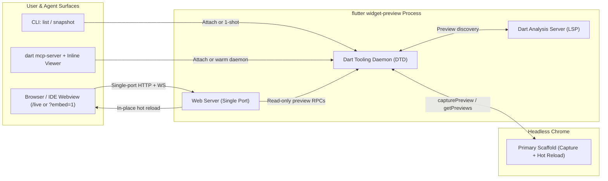

# RFC 510.0000: Headless, CLI, and Interactive Live Widget Previews

**Prototype branches:** [`bkonyi/flutter` (`wp-pr/01` through `wp-pr/11`)](https://github.com/bkonyi/flutter/tree/wp-pr/11-embed-selection) · [`bkonyi/ai` (`wp-mcp-pr/01` through `wp-mcp-pr/04`)](https://github.com/bkonyi/ai/tree/wp-mcp-pr/04-selection-crop)

## Overview

`flutter widget-preview` lets developers inspect `@Preview` widgets without launching a full app, but today it only serves a single local desktop browser or IDE tab. Terminals, CI pipelines, remote workspaces, and AI coding agents have no way to render previews, inspect layout failures, or share a live view.

This RFC adds four capabilities built on existing `@Preview` and `@MultiPreview` annotations:

1. **A single-port `/live` view** with side-by-side Light and Dark previews, drag-to-resize widths, vector zoom, and flash-free hot reload.
2. **MCP tools and an inline viewer** in `dart mcp-server` so AI agents can inspect rendered previews and developers can annotate visual edits right inside chat.
3. **Structured layout diagnostics** that report build errors, exact `RenderFlex` overflow pixels and edges, clipped text, and undersized tap targets.
4. **Headless CLI commands** (`list` and `snapshot`) for terminals, scripts, and CI checks.

## Goals

- Give developers and AI agents visual feedback on isolated Flutter widgets in seconds, without booting an emulator or full app.
- Catch visual and layout regressions early with actionable diagnostics alongside every rendered image.
- Work consistently in local browsers, remote SSH/cloud workspaces, Linux CI containers, and any MCP host with zero extra proxy setup.
- Share one running preview session cleanly across IDEs, browsers, CLI commands, and MCP tools without dirtying tracked repo files.

### Non-Goals

- **Arbitrary snippet injection:** All workflows use real `@Preview` and `@MultiPreview` declarations in project code.
- **Automated gesture scripting:** Programmatic tapping, typing, and scrolling inside a preview remain future work.
- **Replacing `flutter test` goldens:** Snapshots speed up exploratory UI iteration and layout audits; deterministic regression goldens remain the job of `flutter_test`.

## Background

Developers mark isolated UI components with `@Preview`:

```dart
import 'package:flutter/material.dart';
import 'package:flutter/widget_previews.dart';

@Preview(group: 'Cards', name: 'Status Card')
Widget statusCardPreview() {
  return const StatusCard(
    title: 'Release Pipeline',
    badge: 'Draft Ready',
    subtitle: '42 checks passed in 1.8s across Linux, macOS, and Web targets',
  );
}
```

Existing previews work without changes. Generated preview boilerplate also supplies default Material and Cupertino localization delegates when omitted, so standalone widgets like `TextField` and `DropdownButton` render without manual wrapper boilerplate.

## User Journeys and Examples

### Journey 1: Responsive and Theme Iteration in `/live`

Running `flutter widget-preview start` (or following the live link from an MCP chat card) opens `http://localhost:<port>/live` on a single port. Because everything runs through one port, it works identically in local browsers, VS Code Remote SSH, GitHub Codespaces, and IDE webviews.

#### Side-by-side Light and Dark gallery

Selecting **All Previews** with **Light + Dark** displays every grouped preview in both themes at once. Contrast bugs and hardcoded colors stand out immediately.


#### Focused single-preview inspection

Clicking any card opens a focused view with theme toggles, width presets (`375px`, `768px`, `1280px`), editable `W x H` fields, `25%` to `400%` vector zoom, a **Bounds** layout outline toggle, a **Select** region tool, and a copyable preview ID.


A grouped switcher menu lets developers jump between previews across the project without leaving the tab:


#### Drag-to-resize responsive testing

Developers can drag the right or bottom border of the preview frame to see how text wrapping, truncation, and flex layouts respond across breakpoints in real time.


#### Flash-free hot reload

Saving a `.dart` file updates `/live` in place without reloading the page or flashing a white screen.


### Journey 2: AI Agent Self-Checking UI Changes via MCP

Today, an AI coding agent can edit Dart code and run `dart analyze`, but it cannot see whether a widget overflows on a phone screen, loses contrast in Dark mode, or breaks at 2x font size. With `dart mcp-server`:

1. The agent calls `list_widget_previews` to discover the project's `@Preview` declarations.
2. After editing a widget, the agent calls `render_widget_preview` across multiple themes and text scales in one call (or omits `previewId` to inspect the full gallery):

   ```json
   {
     "tool": "render_widget_preview",
     "arguments": {
       "root": "file:///path/to/my_app",
       "previewId": "package:my_app/previews.dart::statusCardPreview",
       "width": 320,
       "variants": ["light", "dark", "large_text"]
     }
   }
   ```

3. The response includes both the rendered PNGs and structured diagnostics. If a row overflows at 2x text scale, the agent receives the exact render object, edge, and pixel count:

   ```json
   {
     "previewId": "package:my_app/previews.dart::statusCardPreview",
     "renderedWidth": 320.0,
     "renderedHeight": 96.0,
     "pixelRatio": 2.0,
     "hasErrors": true,
     "diagnostics": [
       {
         "phase": "paint",
         "kind": "overflow",
         "severity": "error",
         "summary": "A RenderFlex overflowed by 24.0 pixels on the right.",
         "overflowPixels": 24.0,
         "overflowSide": "right",
         "overflowAxis": "horizontal",
         "targetType": "RenderFlex"
       }
     ]
   }
   ```

4. The agent fixes the layout, re-renders (syncing on-disk edits automatically), confirms `hasErrors: false`, and verifies the updated image.

If the developer already has `flutter widget-preview` open in an IDE, `dart mcp-server` attaches to that session. Otherwise, it starts a warm headless daemon and shuts it down automatically after 15 minutes of inactivity.

### Journey 3: Visual Collaboration in Chat

In MCP hosts that support interactive viewer cards, `render_widget_preview` displays an interactive widget preview directly in chat instead of a static image:

- **Before/After comparison:** Clicking **Before/After** reveals a draggable curtain slider comparing the previous render against the new render at 1:1 scale.
- **Point-and-box feedback:** Clicking **Select** (or `Shift`-dragging) lets the developer draw numbered boxes or drop pins on specific elements. Each selection attaches cropped PNGs and logical coordinates (plus matched widget metadata in `/live`), so the developer can write *"center this button"* or *"make this red"* instead of describing positions in prose.
- **One-click live handoff:** Clicking **Interact Live (60fps)** opens the same preview in `/live` with the current theme, viewport size, and zoom preserved.


### Journey 4: Headless CLI Checks in Terminals and CI

Developers and scripts can list and snapshot previews directly from the terminal without opening a browser window.

```sh
flutter widget-preview list
```

```text
Found 4 widget preview(s):
  - package:my_app/previews.dart::statusCardPreview [Cards] "Status Card"
  - package:my_app/previews.dart::themeContrastPreview [Cards] "Theme Contrast Card"
  - package:my_app/previews.dart::primaryActionPreview [Controls] "Primary Action"
  - package:my_app/previews.dart::metricsTilePreview [Telemetry] "Metrics Tile"
```

When no daemon is running, `list` queries the Dart analysis server directly without launching Chrome.

```sh
flutter widget-preview snapshot \
  "Status Card" \
  --width=375 \
  --brightness=dark \
  --text-scale-factor=1.5 \
  --output=snapshots/status_card_dark.png
```

```text
Captured preview package:my_app/previews.dart::statusCardPreview (Status Card) (375.0x112.0 @ 1.0x).
Saved snapshot to snapshots/status_card_dark.png.
```

`snapshot` accepts either a canonical ID (`package:my_app/previews.dart::statusCardPreview`) or a unique `@Preview(name: ...)` shorthand. It also supports `--height`, `--pixel-ratio`, `--pump-ms` (settle delay for animations or async widgets), `--no-image` (diagnostics-only check), and `--machine` (JSON output). If any error diagnostic occurs (compile error, exception, unconstrained layout, or overflow), `snapshot` exits with code `1` so CI jobs can fail on broken layouts.

## How It Works

A single `flutter widget-preview` daemon serves all clients for a project, avoiding duplicate builds and workspace collisions.



- **Shared sessions:** Each preview gets a stable ID (`<libraryUri>::<functionName>`). CLI and MCP clients discover and attach to an existing DTD session for the same project root first, falling back to a headless daemon only when none is running.
- **Off-screen capture and diagnostics:** Snapshot requests render inside an off-screen overlay with explicit theme, size, and text-scale overrides so visible browser tabs stay untouched. Scoped error boundaries and post-layout checks record errors (`compile_error`, `exception`, `unconstrained`, `overflow`) and advisory warnings (`zero_size`, `text_truncated`, `small_tap_target`, `pending_frame`) while keeping Flutter's overflow stripes visible in the PNG.
- **Single-port `/live` and `?embed=1`:** `flutter widget-preview` serves both `/live` (full interactive toolbar) and `/?embed=1` (chromeless IDE webview mode) from one HTTP port, with in-place hot reload, same-origin protections, and a read-only preview WebSocket bridge.
- **Clean headless defaults:** Headless runs keep tracked `.gitignore` files untouched, work out of the box in Linux containers without manual Chrome flags, and let `dart mcp-server` gracefully detect older Flutter SDKs or recover from hung headless sessions.

## Testing

- **Unit tests (`flutter_tools`):** Cover DTD discovery, CLI `list` and `snapshot` behavior, `--machine` JSON output, hot-restart fallback, and `/live` server routing and security boundaries.
- **Widget tests (`widget_preview_scaffold`):** Verify scoped diagnostics, default localizations for bare Material/Cupertino inputs, off-screen `capturePreview` overrides, zoom, `/live` controls, and multi-region selection.
- **Headless Chrome integration tests:** Exercise `start --headless --machine`, `list`, `snapshot`, and real `/live` in-place hot reload end to end.
- **MCP server tests (`dart_mcp_server`):** Cover Pub Workspace root handling, session recovery and idle shutdown, `list_widget_previews`, `render_widget_preview` variants, selection cropping, and headless Chrome DOM tests for the inline viewer.

## Rollout

All changes are additive and backward-compatible with existing `flutter widget-preview start` usage:

1. **Tooling prerequisites (`flutter/flutter`):** Land standalone web and headless Chrome reliability fixes and automatic hot-restart fallback.
2. **Headless runtime and CLI (`flutter/flutter`):** Land DTD services, scoped diagnostics, off-screen `capturePreview`, and the `list`/`snapshot` subcommands.
3. **Interactive `/live` and embed mode (`flutter/flutter`):** Land the single-port `/live` server, chromeless `?embed=1` scaffold, native `/live` controls, and visual region selection.
4. **MCP tools and inline viewer (`dart-lang/ai`):** Land `list_widget_previews`, `render_widget_preview`, `stop_widget_preview`, and the interactive viewer in `dart mcp-server`, checking runtime DTD capabilities per workspace so older Flutter SDKs degrade cleanly with an upgrade message.

## Alternatives Considered

### Host MCP Tools Directly Inside `flutter_tools`

Adding `package:dart_mcp` directly to `flutter_tools` would let `flutter widget-preview` expose an MCP server directly. This was rejected because `dart mcp-server` is already the standard MCP entry point for Dart and Flutter tooling, and keeping `flutter_tools` focused on CLI and DTD primitives avoids adding MCP protocol dependencies to the Flutter SDK tool.

### Synthesize Temporary Previews for Arbitrary Expressions

Allowing agents to pass raw widget snippets would let agents preview widgets without writing `@Preview` annotations. This was rejected because temporary snippets drift out of sync with app imports, leave no reusable preview for human teammates, and complicate static analysis. Real `@Preview` declarations stay version-controlled, analyzer-checked, and useful to both humans and agents.

### Rely on `flutter test` Goldens for Agent UI Verification

`flutter_test` is well suited for deterministic CI regression checks, but writing a full widget test pump harness and golden setup for every exploratory UI tweak adds high friction and misses real browser rendering. Off-screen `@Preview` capture gives immediate visual feedback and structured diagnostics while complementing `flutter_test` once a design settles.
